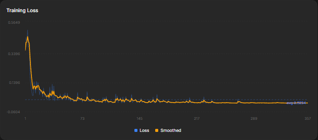
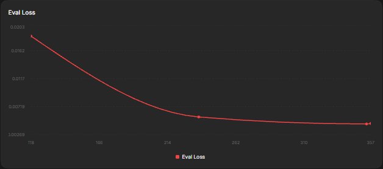

# Llama-3.1-8B-triage-syafiq11: Customer-Message Triage

**Built with Llama.** A fine-tuned Llama 3.1 8B Instruct that reads a customer message and returns a structured triage record.
Fine-tuned using QLoRA (LoRA on a 4-bit base model) with Unsloth Studio. See [why we chose it](#method-and-justification).

**Model:** [syafiq11/Llama-3.1-8B-triage-syafiq11 on Hugging Face](https://huggingface.co/syafiq11/Llama-3.1-8B-triage-syafiq11) · **GGUF:** [download](https://huggingface.co/syafiq11/Llama-3.1-8B-triage-syafiq11-GGUF)

## Contents
- [Overview](#overview)
- [Results](#results)
- [Quick start](#quick-start)
- [Dataset](#dataset)
- [Training](#training)
- [Evaluation](#evaluation)
- [Repository structure](#repository-structure)
- [Limitations](#limitations)
- [License](#license)

## Overview
A fictional online shop in Malaysia receives customer messages in English, Malay, Manglish, Chinese, Tamil, Hindi and other languages, and support staff need them sorted fast. This model labels each message with a category, an urgency and whether a person must handle it, and answers with only a JSON object. The untuned base model gets the category right most of the time but often misjudges urgency and `needs_human`, and wraps its answer in extra text or code blocks; the fine-tune targets those weaknesses.

**Input**
```
My parcel never arrived and I was charged twice.
```

**Output**
```json
{"category": "delivery", "urgency": "high", "needs_human": true}
```

| Field | Values |
|---|---|
| `category` | delivery, refund_return, product_fault, payment_billing, account_access, general_enquiry |
| `urgency` | low, medium, high |
| `needs_human` | true, false |

The labelling rules are in the course's labelling guide (summarised in [Dataset](#dataset)).

## Results
Official course leaderboard: **100 held-out messages** (24 standard, 76 hard), none used in training. Our model is run **1795741468** (team Hello Kitty).

| Model | All three correct | Category | Urgency | needs_human recall | JSON only | Hard cases |
|---|---|---|---|---|---|---|
| Llama 3.1 8B Instruct (untuned, Ollama 4-bit) | 31% | 84% | 40% | 95% | 9% | 30% |
| **Llama-3.1-8B-triage-syafiq11** | **75%** | 94% | 91% | 78% | 99% | 75% |
| Change | **+44 points** | +10 | +51 | −17 | +90 | +45 |

The base model row is the class baseline scorecard ([`results/baseline_scorecard.md`](results/baseline_scorecard.md)); our row is the leaderboard's score for 1795741468, which meets the 75% pass mark. Our model's answers to the 100 messages are in [`results/leaderboard_predictions.jsonl`](results/leaderboard_predictions.jsonl). One message is 1 point, so differences of a few points can be luck.

On the 50 labelled class test messages (`data/test_raw.jsonl`) the same model scores **94%** all three correct (47/50), category 100%, urgency 94%, needs_human recall 95%, JSON only 100% ([`results/report.md`](results/report.md)).

## Quick start
Use the system prompt in [`data/system_prompt.txt`](data/system_prompt.txt) and temperature 0.

### Download
```bash
pip install -U huggingface_hub
hf download syafiq11/Llama-3.1-8B-triage-syafiq11 --local-dir model
```

### Option 1: Python with Unsloth
The Hugging Face repository holds a LoRA adapter; Unsloth loads the base model for it automatically.
```python
from unsloth import FastLanguageModel

model, tokenizer = FastLanguageModel.from_pretrained("model", max_seq_length=2048, load_in_4bit=True)
FastLanguageModel.for_inference(model)

messages = [
    {"role": "system", "content": open("data/system_prompt.txt", encoding="utf-8").read()},
    {"role": "user", "content": "My parcel never arrived and I was charged twice."},
]
inputs = tokenizer.apply_chat_template(messages, add_generation_prompt=True, return_tensors="pt").to(model.device)
output = model.generate(input_ids=inputs, max_new_tokens=64, do_sample=False)
print(tokenizer.decode(output[0][inputs.shape[1]:], skip_special_tokens=True))
```

### Option 2: Unsloth Studio
1. Add the model in Studio and load it in the **Chat** tab.
2. Paste the system prompt, set temperature to 0, and send a message.

### Option 3: Ollama
```bash
ollama run hf.co/syafiq11/Llama-3.1-8B-triage-syafiq11-GGUF:Q4_K_M
```
Or with the system prompt built in, using [`serving/Modelfile`](serving/Modelfile):
```bash
ollama create triage -f serving/Modelfile
ollama run triage "My parcel never arrived and I was charged twice."
```

### Option 4: vLLM (adapter on top of the base model)
```bash
vllm serve unsloth/Llama-3.1-8B-Instruct --enable-lora --lora-modules triage=syafiq11/Llama-3.1-8B-triage-syafiq11 --max-model-len 2048
```
```bash
curl http://localhost:8000/v1/chat/completions -H "Content-Type: application/json" -d '{
  "model": "triage",
  "temperature": 0,
  "messages": [
    {"role": "system", "content": "<contents of data/system_prompt.txt>"},
    {"role": "user", "content": "My parcel never arrived and I was charged twice."}
  ]
}'
```

### Requirements
| Option | Hardware |
|---|---|
| Unsloth | NVIDIA GPU, about 8 GB VRAM (4-bit) |
| Ollama (Q4_K_M) | CPU or GPU, about 8 GB RAM |
| vLLM | Linux, NVIDIA GPU, about 20 GB VRAM (16-bit base) |

## Dataset

| Split | File | Examples | Source | Languages |
|---|---|---|---|---|
| Train | [`data/train_chat_v6_merged.jsonl`](data/train_chat_v6_merged.jsonl) (chat format) | 994 | 157 class rows (`train_raw.jsonl`), 50 class rows (`data_starter.xlsx`, S001–S050), 787 rows added for this project | English, Malay, Manglish, Chinese, Tamil, Hindi/Hinglish, Spanish, French |
| Test (class, labelled) | [`data/test_raw.jsonl`](data/test_raw.jsonl) | 50 (30 standard, 20 hard) | class data | English, Malay |
| Leaderboard test | [`data/leaderboard_test_100_messages.xlsx`](data/leaderboard_test_100_messages.xlsx) | 100 (24 standard, 76 hard) | class data, labels held by the instructor | mixed |

**Label distribution (training set)**

| Category | Count |
|---|---|
| delivery | 183 |
| refund_return | 174 |
| product_fault | 178 |
| payment_billing | 156 |
| account_access | 152 |
| general_enquiry | 151 |

| urgency: low | medium | high | needs_human: true | false |
|---|---|---|---|---|
| 279 | 497 | 218 | 396 | 598 |

**Format.** Chat file, one conversation per line:
```json
{"messages": [{"role": "system", "content": "..."}, {"role": "user", "content": "..."}, {"role": "assistant", "content": "{\"category\": \"delivery\", \"urgency\": \"low\", \"needs_human\": false}"}]}
```
Class files (`train_raw.jsonl`, `test_raw.jsonl`), one object per line:
```json
{"id": "T001", "message": "...", "category": "delivery", "urgency": "low", "needs_human": false}
```

- **Labelling rules:** category = what the customer needs help with; urgency **high** for a safety hazard, possible account or card misuse, money taken with no order, legal/regulator/press mentions, a deadline within 2 days, or someone pretending to be the shop; **medium** when something is wrong with no hazard or near deadline; **low** for questions, requests and feedback. `needs_human` is true when urgency is high, the customer has contacted the shop twice or more about the same problem, or a refund is overdue by more than 14 days.
- **Cleaning:** all 994 messages are unique and none of the 50 class test messages or the 100 leaderboard messages appears in the training data (checked by exact match). `scripts/check_dataset.py` finds no label-rule errors; its duplicate warnings for Chinese, Tamil and Hindi rows are false alarms, because its text normaliser removes non-Latin characters.
- **Data licence:** class data from the course (`train_raw.jsonl`, `data_starter.xlsx`, `test_raw.jsonl`, leaderboard messages), published with permission. The 787 added rows are released under CC BY 4.0.

## Training

### Method and justification
**Chosen method:** QLoRA: LoRA adapters trained on a 4-bit quantised base model, supervised fine-tuning on chat examples.

| Option considered | For | Against | Chosen? |
|---|---|---|---|
| Prompting only (no training) | No cost | Base model scores 31% all-three-correct and adds extra text 91% of the time | No |
| Full fine-tuning | Most capacity to change the model | Needs several large GPUs for 8B; easy to overfit 994 examples; 16 GB of weights to publish | No |
| LoRA (16-bit base) | Small adapter, keeps base ability | Needs about twice the VRAM of QLoRA | No |
| QLoRA (4-bit base) | Fits one rented GPU, fast, small adapter, keeps base ability | Small quality loss from 4-bit base | **Yes** |

**Why this method:** the task is a narrow, fixed-format classification. The base model already knows the categories, so we only need to teach the labelling rules and the JSON-only answer. With under 1,000 examples, one rented GPU and limited time, QLoRA trains in about an hour, produces a small adapter, and serves through Unsloth, vLLM (LoRA) or a merged GGUF in Ollama.

**Base model and why:** Llama 3.1 8B Instruct (`unsloth/Llama-3.1-8B-Instruct-unsloth-bnb-4bit`): the class baseline model, multilingual, follows instructions well, and small enough to run on a laptop once quantised.

**Evidence:** training and evaluation loss both fall steadily and evaluation loss is still going down at the last step, so there is no sign of overfitting after 3 epochs (see curves below).

### Settings

| Setting | Value |
|---|---|
| Base model | `unsloth/Llama-3.1-8B-Instruct-unsloth-bnb-4bit` |
| Method | QLoRA (LoRA on 4-bit base) |
| Tool and version | Unsloth Studio, PEFT 0.18.1 |
| Epochs / steps | 3 epochs, 357 steps (checkpoint every 118 steps) |
| Learning rate | 0.0001, cosine schedule, 20 warmup steps |
| Batch size | 2 per device × 4 gradient accumulation = 8 |
| Adapter settings | rank 32, alpha 32, dropout 0.05, all linear layers (q, k, v, o, gate, up, down) |
| Optimizer | AdamW 8-bit, weight decay 0.01 |
| Max sequence length | 2048 |
| Seed | 3407 |
| Hardware | GrafiLab cloud GPU |
| Training time | 1 h 12 min (427,416 tokens) |
| Training run | 1795741468 |

### Training curves
| Training loss | Evaluation loss |
|---|---|
|  |  |

Training loss drops from about 0.56 to near zero within the first 30 steps, then stays flat (final loss 0.0003). Evaluation loss goes from about 0.020 at step 118 to about 0.003 at step 357 and is still slowly decreasing, so the model has not started to overfit the evaluation split. A very low training loss mostly shows the model has learned the fixed JSON format; the leaderboard score is the real test.

### Reproduce
```bash
git clone https://github.com/syaf1q1/triage-project.git
cd triage-project
pip install -r requirements.txt
python scripts/check_dataset.py --train data/train_raw.jsonl --test data/test_raw.jsonl
```
Then in Unsloth Studio: **Train → Configure**, base model `unsloth/Llama-3.1-8B-Instruct-unsloth-bnb-4bit`, method QLoRA, upload `data/train_chat_v6_merged.jsonl`, and use the settings in the table above (also in [`config/training_settings.md`](config/training_settings.md)).

## Evaluation
Serve the model (for example with Ollama as above), then run:
```bash
cd scripts
python auto_eval.py --test ../data/test_raw.jsonl --ollama triage --out ../results
```
Commands used (Ollama model built from [`serving/Modelfile`](serving/Modelfile)):
```bash
cd scripts
python auto_eval.py --test ../data/test_raw.jsonl --ollama triage --out ../results
python predict.py --questions ../data/leaderboard_test_100_messages.xlsx --ollama triage --out ../results/leaderboard_predictions.jsonl
```
The second command writes the answers that were uploaded to the class leaderboard.

**Error analysis (50 class test messages, 3 wrong).** All answers were valid JSON with no extra text, and every category was right; all 3 mistakes are urgency.

| Message | Expected | Predicted | Why |
|---|---|---|---|
| My card was charged but the order page says payment failed and there is no order in my history. | payment_billing, high, true | payment_billing, medium, false | Missed the rule "money taken and there is no order → high". The most serious error: a case that needs a person was not flagged. |
| I forgot which email I used to register. Can you look it up with my phone number? | account_access, medium, false | account_access, low, false | Read a polite question as "nothing is wrong", but the customer cannot reach their account. |
| I will leave a 1-star review everywhere unless my refund of RM60 is processed. | refund_return, medium, false | refund_return, high, true | Treated a review threat like a legal or press threat. Errs on the safe side. |

**On the leaderboard set**, `needs_human` recall fell from 95% (base) to 78%: the base model flags almost everything for a person, while ours is more selective (precision rises) but misses some cases. Reading our answers, the clearest pattern is refunds overdue by more than 14 days answered with `needs_human: false`. Other weak spots are deadline arithmetic ("party on 1 June, today is 29 May") and messages with several issues, where it sometimes picks the first issue instead of the most urgent one.

## Repository structure
```
.
├── README.md
├── LICENSE
├── requirements.txt
├── assets/       training curves and screenshot
├── config/       training settings
├── data/         datasets and system prompt
├── scripts/      data preparation, data check, evaluation, leaderboard predictions
├── serving/      Ollama Modelfile
├── huggingface/  model card and licence files uploaded to Hugging Face
└── results/      baseline scorecard, our evaluation report and predictions
```

## Limitations
- `needs_human` recall on the leaderboard set is 78%, lower than the untuned model's 95%: some customers who need a person would not be flagged, most often refunds overdue by more than 14 days.
- Date arithmetic for deadlines and overdue refunds, and messages with several issues, are its other weak points.
- Of the 787 added training rows, about 513 are English and 119 Malay/Manglish; Chinese, Spanish, Tamil, Hindi/Hinglish and French have only 20–40 each (rough count by script and keywords), so those languages are likely weaker. Languages not in the data (for example German) are untested.
- Urgency depends on dates and counts inside the message ("refund due on 1 May, today is 22 May"); date arithmetic is a known weak point of small models.
- Messages that mix two or three issues must follow the "higher urgency first" rule, which the model can get wrong.
- Not for decisions without human review: labels can be wrong, and a missed high-urgency safety message could cause harm.

## License
- Code: MIT (see [`LICENSE`](LICENSE)). Files in `scripts/` are course tools, included so the evaluation can be reproduced.
- Model: built on Llama 3.1 and subject to the [Llama 3.1 Community License](https://github.com/meta-llama/llama-models/blob/main/models/llama3_1/LICENSE) and [Acceptable Use Policy](https://llama.meta.com/llama3_1/use-policy). **Built with Llama.**
- Data: class data from the course, published with permission; rows added for this project under CC BY 4.0.

## Citation
```bibtex
@misc{syafiq11_triage_2026,
  author = {syafiq11},
  title  = {Llama-3.1-8B-triage-syafiq11: Customer-Message Triage},
  year   = {2026},
  url    = {https://github.com/syaf1q1/triage-project}
}
```

## Acknowledgements
Unsloth and Unsloth Studio · Meta Llama 3.1 · GEN AI EEPGENAI001 course materials and tools

## Authors
syafiq11
